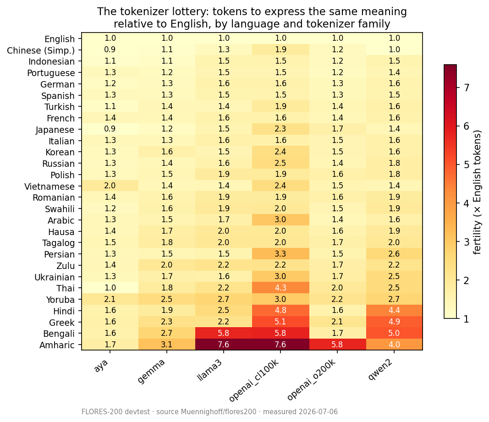
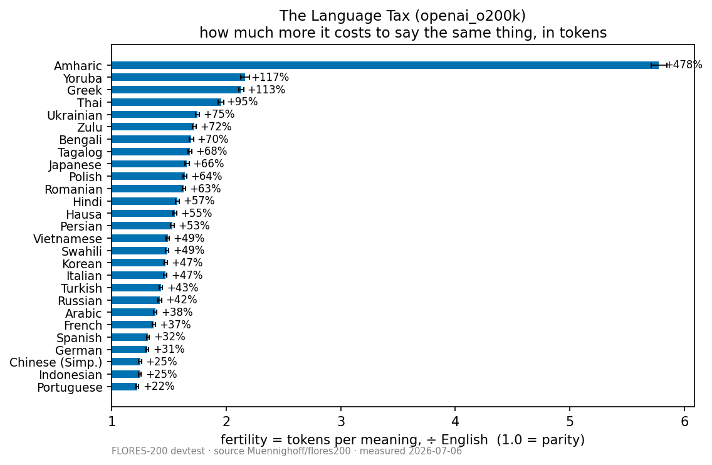
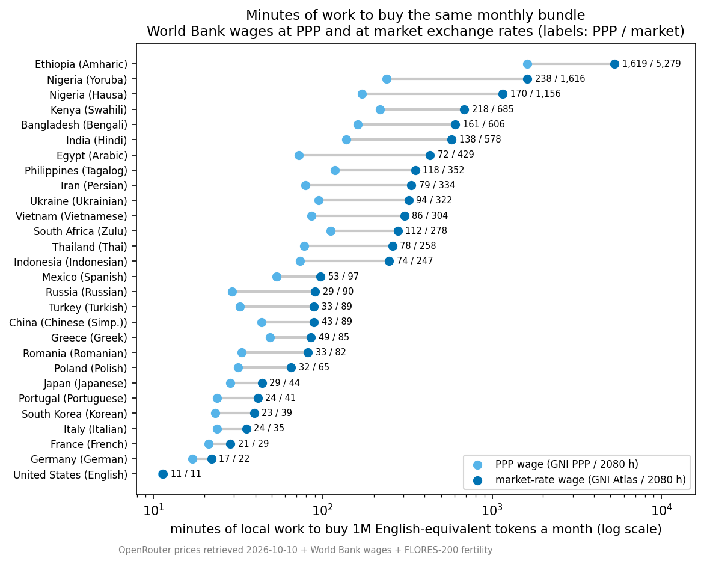
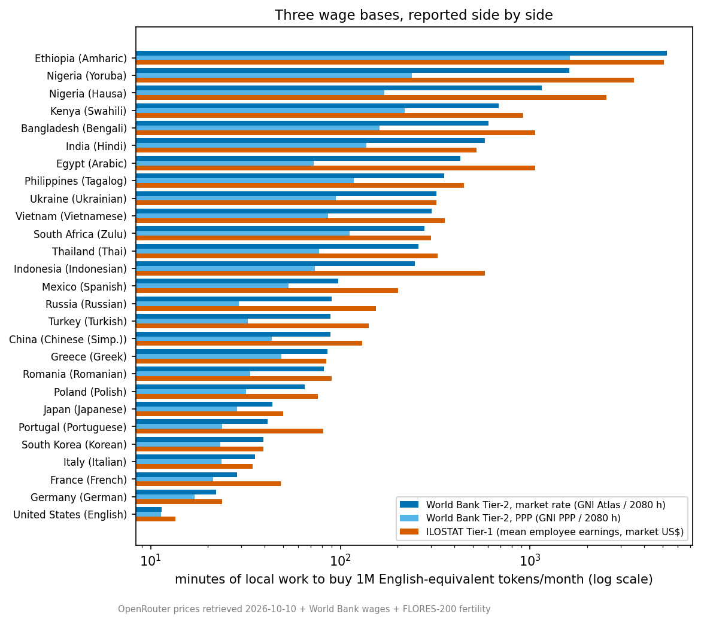
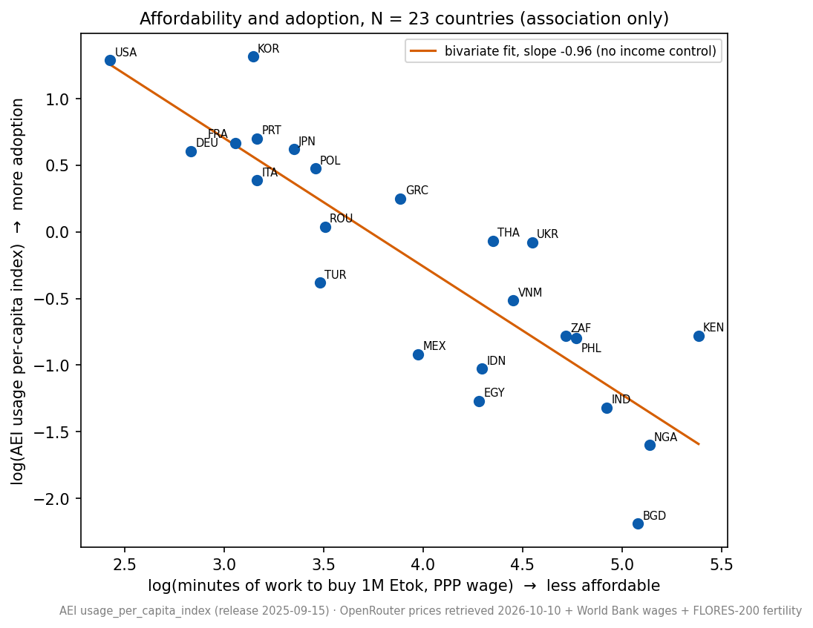

# The Cost of Intelligence: A Multi-Country Token Affordability Index and Its Link to AI Adoption

<!-- begin:github-only -->
**Elmer Santos**

> This is the source text of the paper. The arXiv source (`paper/main.tex`) and PDF (`paper/main.pdf`) are built from it with `make paper`. Every number below is regenerated from the committed data by `make results`.
<!-- end:github-only -->

## Abstract

Large language models are sold at one US-dollar price per token, but a token is not a fixed unit of meaning: many languages need more tokens than English to say the same thing. We extend "The African Language Tax" (Somide, 2026) from cost to affordability and adoption, and from African languages to the Lusophone and Hispanophone Global South. We measure tokenizer fertility for 28 languages and six tokenizer families on FLORES-200, combine it with OpenRouter list prices retrieved on 2026-10-10 and three wage bases (World Bank GNI per capita at market exchange rates and at purchasing-power parity, and ILOSTAT mean earnings of employees), and define four family-stratified instruments. The main one counts the minutes of local work needed to buy one million English-equivalent tokens a month. At the gpt-4o price, that bundle costs about 11 minutes of work in the United States. In Amharic in Ethiopia it costs about 1,620 minutes at PPP wages and about 5,280 minutes at market-rate wages, roughly 140 and 460 times as much. Wages, not fertility, drive most of the spread across countries. We then relate the index to the Anthropic Economic Index for 23 countries. The rank correlation with adoption is strong (Spearman ρ = −0.85), but affordability is almost collinear with income (r = −0.98), and with GDP per capita controlled its coefficient is close to zero (−0.05, p = 0.92). The checks in our analysis plan do not make this robust: the coefficient is negative under every wage basis but significant only with ILOSTAT wages (p = 0.02), and leaving out single countries flips its sign six times. In this sample the tokenizer tax adds nothing detectable to income as a predictor of adoption. Data, code and figures are released under open licenses.

## 1. Introduction

The token is the unit in which large language models (LLMs) are bought and sold. Providers bill per input token and per output token, and they quote one list price in US dollars, the same for a buyer in Lisbon as for one in Luanda. A token is not a unit of meaning, though. Tokenizers trained mostly on English text encode English compactly and split many other languages into more pieces. The standard measure of this is *fertility*: the number of tokens a tokenizer needs for a text, relative to the same text in English. Under the tokenizer used by OpenAI's gpt-4o, Portuguese needs about 22% more tokens than English for the same sentences, and Amharic about 5.8 times as many (Section 5.1). A flat price per token is therefore an unequal price per meaning (Petrov et al., 2023; Ahia et al., 2023).

That inequality compounds with a second, larger one. Many speakers of high-fertility languages earn low wages, and they pay a dollar price out of local earnings. What matters to a buyer is not the dollar cost but how much of their own working time it takes to pay it. This paper measures that quantity and asks whether it is related to who uses AI.

We extend *The African Language Tax* from cost measurement to affordability measurement and adoption consequences, and from African languages to the Lusophone/Hispanophone Global South.

Somide (2026) measured the cost, latency and context penalty of tokenizing African languages in frontier models, carried the cost through exchange rates, and gave one wage equivalence for one deployment. We make four contributions.

1. **An affordability index.** We express a fixed monthly bundle of one million English-equivalent tokens as minutes of local work, for 28 languages and 40 countries, under three wage bases (Sections 3 and 5.2). On the World Bank basis the index is a rescaled form of the ITU's affordability ratio of price to monthly income (ITU, 2025).
2. **Reusable instruments.** We define a real exchange rate for machine text, $e_{\text{real}}$ (English-equivalent tokens per US dollar), and an *Intelligence Wage* (English-equivalent tokens per hour of local work). Both are stratified by tokenizer family (Section 3).
3. **An adoption test.** We relate the index to country-level usage in the Anthropic Economic Index (Appel et al., 2025), controlling for income and internet use (Section 6). This extends Misra et al. (2025), who link a country's language-resource status to AI adoption, to a measure built from tokenizers and wages.
4. **A Lusophone and Hispanophone cut.** We show how one Portuguese or Spanish tokenizer penalty becomes very different burdens in Portugal, Brazil, Angola and Mozambique, and in Spain, Mexico and Colombia (Section 5.3).

The headline gap is large on every wage basis. At the gpt-4o price, the bundle costs about 11 minutes of work in the United States. In Amharic in Ethiopia it costs about 1,620 minutes at purchasing-power-parity (PPP) wages and about 5,280 minutes at market-rate wages: roughly 140 and 460 times as much. Fertility accounts for a factor of 5.8 in that gap. Wages account for the rest.

The adoption result is a null, and we report it as one. Countries where the bundle costs more work use Claude much less per head (Spearman ρ = −0.85). But in our 23-country panel affordability is almost collinear with income, and once GDP per capita is controlled its coefficient is close to zero. The checks in our analysis plan do not make this result robust (Section 6.4).

## 2. Related work

**Tokenizer disparities.** Petrov et al. (2023) showed that tokenizers assign systematically different token counts to the same content in different languages, with consequences for cost, latency and context length. Ahia et al. (2023) measured the resulting differences in API cost and related them to the Human Development Index of each language's main country, as a proxy for affordability. Solatorio et al. (2024) linked the premium on FLORES-200 to World Bank income groups. Lundin et al. (2025) related fertility to accuracy and training cost for 16 African languages. Recent work extends token counts to European languages including Portuguese and Spanish (Ovcharov, 2026), to Indian languages (Srivastava, 2026) and to French (Serval, 2026), and Roy et al. (2026) audit the cost premium for underserved language communities. Our fertility measurements replicate this literature on six tokenizer families. They are an input to our analysis, not its contribution.

**The anchor paper.** Somide (2026) is the work we extend most directly. It quantifies the cost, latency and context penalty of African languages in frontier models, converts costs into local currencies (its Section 6.3) and shows that the tokenization penalty and currency depreciation compound (Section 6.6). Its Section 10.1 gives one wage equivalence: the annual cost of an illustrative Amharic customer-service deployment "represents roughly 1,340 annual salaries at the Nigerian minimum wage". It does not build a multi-country affordability index, link the penalty to adoption data, or cover Portuguese or Spanish.

**Cost relative to income.** Besides Ahia et al. (2023) and Solatorio et al. (2024), Sathish et al. (2024) compared a flat monthly subscription price with incomes across countries. The ITU's affordability reports express the price of a service basket as a share of monthly gross national income (GNI) per capita, against the Broadband Commission's target of less than 2% (ITU, 2025). None of these builds a per-country index of the working time needed for a fertility-adjusted token bundle.

**Minutes of work.** Expressing a price as the working time needed to pay it has a long history. UBS's *Prices & Earnings* reports, last published in 2018, compared how long people in different cities had to work to buy the same goods (UBS Global Wealth Management, 2018). Ashenfelter (2012) used Big Macs per hour of work as a measure of real wages. Our Intelligence Wage applies the same idea with fertility-adjusted tokens as the good. We do not borrow the inference of *The Economist*'s Big Mac index, which compares one good's local prices to judge whether currencies are over- or under-valued (The Economist, n.d.). That inference needs the good's price to differ across countries, and a token's price does not (caveat C1, Section 8).

**Falling prices.** The Stanford AI Index reports that the cost of inference for a system performing at the level of GPT-3.5 fell more than 280-fold between November 2022 and October 2024 (Stanford HAI, 2025). Epoch AI documents fast but uneven price declines across tasks (Cottier et al., 2025), and commercial indices track token prices over time (Silicon Data, n.d.; BenchLM, n.d.). Zhu (2026) builds a quality-adjusted price index for AI services. We take prices as given from one snapshot. Our contribution sits downstream of price.

**Adoption.** The Anthropic Economic Index reports Claude usage by country and finds that a 1% increase in GDP per capita is associated with a 0.7% increase in usage per capita (Appel et al., 2025; Anthropic, 2025). Misra et al. (2025) find that countries whose main languages are low-resource have an AI-user share about 20% below otherwise similar countries. Daepp and Slaughter (2026) describe how early use of generative AI varied by country income and language. None of these measures tokenizer cost or wages. Clio (Tamkin et al., 2024) describes the privacy-preserving approach Anthropic uses to study real-world use of Claude.

## 3. The four instruments

Every instrument is defined for one tokenizer family $k$, because there is no universal token (caveat C3, Section 8). Let $f$ be the fertility of a language under family $k$: the total number of tokens for the FLORES-200 devtest sentences in that language, divided by the total for the aligned English sentences, so that English is 1 by construction. Let $p_{\text{in}}$ and $p_{\text{out}}$ be the list prices, in US dollars per million tokens, of the family's anchor model, and $w$ an hourly wage in US dollars.

**Blended price.** Input and output tokens are priced differently, so we combine them:

$$p_{\text{blend}} = \frac{p_{\text{in}} + r\,p_{\text{out}}}{1 + r},$$

where $r$ is the number of output tokens per input token. We set $r = 3$. This is an assumption, not a measured usage figure, and we vary it over 1, 3 and 9 (caveat C2). For gpt-4o at US\$2.50 (input) and US\$10.00 (output) per million tokens, $p_{\text{blend}}$ is US\$8.125 per million tokens.

**English-equivalent tokens.** An English-equivalent token (Etok) is the amount of content that one token carries in English under the same tokenizer. A text that needs $f$ tokens per Etok in some language costs $f$ times as much as its English version.

**Instrument 1: the real exchange rate for machine text.**

$$e_{\text{real}} = \frac{10^6 / p_{\text{blend}}}{f} \quad \text{[Etok per US\$]}.$$

For English under gpt-4o this is about 123,000 Etok per dollar. For Amharic it is about 21,300.

**Instrument 2: the Intelligence Wage.** The English-equivalent tokens that one hour of local work buys:

$$\mathrm{IW} = e_{\text{real}} \times w \quad \text{[Etok per hour]}.$$

At PPP wages it is about 5.3 million Etok per hour in the United States and about 37,000 in Ethiopia.

**Instrument 3: the work-minutes affordability index.** The minutes of local work needed to buy a bundle of $B$ English-equivalent tokens a month:

$$\mathrm{WM} = \frac{B \cdot f \cdot p_{\text{blend}} / 10^6}{w} \times 60 = \frac{60\,B}{\mathrm{IW}}.$$

We set $B$ to one million Etok a month, about 750,000 words of English by the common rule of thumb of three-quarters of a word per token. The bundle is a yardstick chosen for legibility. WM is exactly proportional to $B$ (this is unit-tested), so readers can rescale to any other budget.

**Instrument 4: the Language Tax.** The percentage surcharge a language pays over English for the same content:

$$\text{tax} = f - 1.$$

**Link to the ITU affordability ratio.** With the World Bank wage, $w$ = GNI per capita ÷ 2,080 hours, WM is exactly 104 times the bundle's cost as a percentage of monthly GNI per capita, the ratio the ITU uses for broadband (ITU, 2025). The Broadband Commission's 2% target therefore corresponds to 208 minutes.

## 4. Data

### 4.1 Fertility

We measure fertility on the FLORES-200 devtest split, 1,012 sentences translated into each language (NLLB Team et al., 2022; NLLB Team, 2024). We read it from the ungated Hugging Face copy `Muennighoff/flores200`, because the canonical `flores_plus` dataset is gated. The 28 languages are English, Portuguese, Spanish, French, German, Italian, Romanian, Polish, Greek, Russian, Ukrainian, Turkish, Arabic, Persian, Hindi, Bengali, Chinese (Simplified), Japanese, Korean, Thai, Vietnamese, Indonesian, Tagalog, Swahili, Hausa, Yoruba, Zulu and Amharic. The six tokenizer families are OpenAI o200k, OpenAI cl100k, Llama 3, Qwen 2.5, Gemma 2 and Aya. Tokenizers are loaded through the author's `tokenlab` harness, which pins one tokenizer per family. Confidence intervals (95%) come from a paired sentence-level bootstrap with 10,000 resamples.

### 4.2 Prices

Prices are OpenRouter's list prices, read from its public models API (OpenRouter, n.d.) on 2026-10-10 (458 models listed). We choose one flagship anchor model per family by fixed rules in the code (Table 1), and every headline number uses gpt-4o. The repository also records a small-model anchor for each family, which no result in this paper uses. No cl100k-family model is used as an anchor, so the instruments cover five families. Using Cohere's Command R+ as the price anchor for the Aya family is an assumption: we take it to share the Aya tokenizer. The listed price is OpenRouter's headline price for each model. Some providers on OpenRouter charge less.

An earlier snapshot, taken on 2026-07-06, is kept in the repository. Between the two snapshots one flagship price changed, Llama 3's (from US\$0.10 and US\$0.32 to US\$0.22 and US\$0.50), as did two small-model prices. The gpt-4o price did not change, so the headline numbers and the adoption results are the same under both snapshots.

*Table 1. Flagship anchor models and their list prices (US\$ per million tokens, OpenRouter, 2026-10-10). $p_{\text{blend}}$ uses $r = 3$.*

| Family | Anchor model | Input | Output | $p_{\text{blend}}$ |
|---|---|--:|--:|--:|
| OpenAI o200k | `openai/gpt-4o` | 2.50 | 10.00 | 8.125 |
| Llama 3 | `meta-llama/llama-3.3-70b-instruct` | 0.22 | 0.50 | 0.430 |
| Qwen 2.5 | `qwen/qwen-2.5-72b-instruct` | 0.36 | 0.40 | 0.390 |
| Gemma 2 | `google/gemma-2-27b-it` | 0.65 | 0.65 | 0.650 |
| Aya | `cohere/command-r-plus-08-2024` | 2.50 | 10.00 | 8.125 |

### 4.3 Wages

We report three wage bases side by side and do not pick one as the answer. The World Bank series come from the World Development Indicators (World Bank, n.d.) and the earnings series from ILOSTAT (International Labour Organization, n.d.).

- **World Bank, market rate (Tier 2).** GNI per capita, Atlas method, in current US dollars (indicator `NY.GNP.PCAP.CD`), divided by 2,080 hours a year. Available for all 40 countries, for 2025.
- **World Bank, PPP (Tier 2).** GNI per capita at purchasing-power parity, in current international dollars (`NY.GNP.PCAP.PP.CD`), divided by 2,080 hours. Available for all 40 countries, for 2025.
- **ILOSTAT (Tier 1).** Mean monthly earnings of employees in US dollars (ILOSTAT dataflow `DF_EAR_EMTA_SEX_CUR_NB`, both sexes, all economic activities), divided by 40 hours × 4.333 weeks. We take the latest year for each country, from 2019 to 2025 (median 2024). Available for 38 of the 40 countries; Iran and Morocco are missing.

The 2,080 hours and the 40-hour week are our assumptions. Both World Bank bases are national averages that ignore inequality and informal work.

**Which basis is like-for-like?** A token is priced in US dollars and paid for at market exchange rates. The market-rate wage is therefore the like-for-like basis for "minutes of work". A PPP wage is larger than the market-rate wage wherever local prices are low, so dividing a dollar price by a PPP wage understates the burden. PPP-based minutes answer a different question: how long a worker would have to work if tokens were priced like local goods. For every country in our panel they are lower than the market-rate minutes. We show both in every headline result.

ILOSTAT measures what employees actually earn, but it excludes the self-employed and most informal work. For 27 of the 38 countries the ILOSTAT hourly wage is below the World Bank market-rate proxy (median ratio 0.85), so ILOSTAT minutes are usually higher. Where employees are a small and better-paid part of the workforce, the ILOSTAT wage can be far above the proxy: in Mozambique it is US\$1.23 an hour, against US\$0.27 from GNI.

### 4.4 Countries

Each language has one *primary* country, used for the headline results and the adoption regression, and may have *alternate* countries, used in sensitivity checks. For example, Portuguese has Portugal as its primary country and Brazil, Angola and Mozambique as alternates, and Spanish has Mexico as its primary country and Spain and Colombia as alternates. The 28 languages give 27 distinct primary countries, because Nigeria is the primary country for both Hausa and Yoruba, plus 13 further alternate countries: 40 countries in all. The mapping is in `config/country_language.yaml`.

### 4.5 Adoption outcome and controls

The outcome is the Anthropic Economic Index (Appel et al., 2025), Hugging Face dataset `Anthropic/EconomicIndex`, release `release_2025_09_15`, country level. It covers Claude.ai (Free and Pro) usage over one week, 4 to 11 August 2025. We use `usage_per_capita_index`: a country's share of Claude.ai usage divided by its share of the working-age population, so that 1.0 means usage in proportion to population (Anthropic, 2025, calls this the Anthropic AI Usage Index). The release has 201 country-level geographies, 166 of them with positive usage. For example, the index is 3.62 for the United States, 2.01 for Portugal, 0.93 for Brazil, 0.40 for Mexico, 0.095 for Mozambique and 0.046 for Angola (157th of the 166).

The controls are GDP per capita at PPP for 2024 (`NY.GDP.PCAP.PP.CD`) and internet users as a percentage of the population for 2024, or 2025 for four countries (`IT.NET.USER.ZS`). The panel is the 27 primary countries. China, Ethiopia, Iran and Russia have no value in the index, which leaves 23 countries. Nigeria enters once, with Hausa, the first of its two languages in the mapping. Ethiopia, the headline affordability case, is therefore not in the regression.

### 4.6 Reproducibility

Raw responses from every source are kept in the repository with their retrieval times, except the Economic Index file, which `src/aei.py` downloads from Hugging Face. One command, `make results`, regenerates every derived number, figure and report in this paper from the committed data without network access. The full pipeline, including new data pulls, runs with `make all`.

## 5. Results

### 5.1 Fertility and the tokenizer lottery

Fertility rises steeply for lower-resourced languages and scripts, and it depends heavily on the tokenizer (Figure 1). Under o200k the median non-English fertility is 1.53. It ranges from 1.22 for Portuguese to 5.78 for Amharic, whose 95% confidence interval is 5.71 to 5.85. Expressed as the Language Tax (Figure 2), the surcharge over English is 22% for Portuguese, 32% for Spanish, 37% for French, 38% for Arabic, 49% for Swahili, 55% for Hausa, 57% for Hindi, 72% for Zulu, 117% for Yoruba and 478% for Amharic.

The same content costs a very different number of tokens depending on which family a request reaches. We call this the *tokenizer lottery*. The older OpenAI cl100k tokenizer has the highest fertility for every one of the 27 non-English languages. Aya's tokenizer has the lowest for 22 of them. Amharic needs 1.71 tokens per Etok under Aya and 7.59 under cl100k and Llama 3, a 4.5-fold difference for identical text. The spread is similar for Thai (0.99 to 4.34) and Bengali (1.57 to 5.80). For Portuguese and Spanish it is small: 1.22 to 1.48, and 1.26 to 1.54.

*Figure 1. Fertility by language and tokenizer family on FLORES-200 devtest (tokens relative to English; English = 1.0). Languages are sorted by their mean across families.*

*Figure 2. The Language Tax under the OpenAI o200k family: surcharge over English, with 95% bootstrap confidence intervals.*

### 5.2 Affordability under three wage bases

Folding in wages widens the gap far beyond what fertility alone produces (Table 2, Figures 3 and 4). At market-rate wages, the bundle costs 11 minutes of work in the United States, 41 in Portugal, 97 in Mexico, 685 in Kenya, 1,156 in Nigeria (Hausa) and 5,279 in Ethiopia (Amharic). At PPP wages the same bundle costs 11, 24, 53, 218, 170 and 1,619 minutes. Ethiopia's figure is about 143 times the United States' at PPP wages, 462 times at market rates and 378 times with ILOSTAT earnings. At market rates, the bundle would take about half of Ethiopia's monthly GNI per capita (51%), against 0.11% in the United States.

*Table 2. Minutes of local work to buy one million English-equivalent tokens a month (o200k family, gpt-4o price, $r = 3$). The last column gives the market-rate cost as a share of monthly GNI per capita (WM ÷ 104).*

| Country | Language | Fertility | WB PPP | WB market rate | ILOSTAT | Share of monthly GNI |
|---|---|--:|--:|--:|--:|--:|
| United States | English | 1.000 | 11 | 11 | 13 | 0.11% |
| Germany | German | 1.311 | 17 | 22 | 24 | 0.21% |
| Portugal | Portuguese | 1.222 | 24 | 41 | 81 | 0.40% |
| Mexico | Spanish | 1.316 | 53 | 97 | 202 | 0.93% |
| South Africa | Zulu | 1.721 | 112 | 278 | 300 | 2.7% |
| Egypt | Arabic | 1.381 | 72 | 429 | 1,067 | 4.1% |
| India | Hindi | 1.573 | 138 | 578 | 521 | 5.6% |
| Kenya | Swahili | 1.486 | 218 | 685 | 919 | 6.6% |
| Nigeria | Hausa | 1.550 | 170 | 1,156 | 2,533 | 11.1% |
| Nigeria | Yoruba | 2.167 | 238 | 1,616 | 3,541 | 15.5% |
| Ethiopia | Amharic | 5.779 | 1,619 | 5,279 | 5,089 | 50.8% |

The full table for all 42 language and country pairs is in Appendix A.

**Where the gap comes from.** Within one family, WM is fertility divided by the wage, times a constant. Between the United States and Ethiopia, fertility contributes a factor of 5.8, and the wage a factor of 25 at PPP or 80 at market rates. On a log scale fertility is 35% of the gap at PPP and 29% at market rates. Across all 28 language and country pairs, the variance of the log market-rate wage is 17 times that of log fertility, so wages drive most of the spread. The two penalties also stack: in our sample, languages with higher fertility tend to be spoken in countries with lower wages (Spearman ρ = −0.46 between o200k fertility and the market-rate wage, p = 0.01).

**How much the wage basis matters.** Market-rate minutes are between 1.0 times (United States) and 6.8 times (Nigeria) the PPP minutes. ILOSTAT minutes are higher than market-rate minutes in most countries, because measured mean earnings are usually below GNI per head: Portugal rises from 41 to 81, Mexico from 97 to 202, Egypt from 429 to 1,067 and Nigeria (Hausa) from 1,156 to 2,533. They are lower in a few countries, most of all Mozambique (486 against 2,175). The order of magnitude of the gradient holds on every basis. The multiple for the poorest countries depends on the basis by a factor of up to about three.

*Figure 3. Minutes of local work to buy one million English-equivalent tokens a month, at World Bank PPP and market-rate wages (o200k family, gpt-4o price, $r = 3$; log scale). Labels give PPP and market-rate minutes.*

*Figure 4. The same index under all three wage bases, including ILOSTAT mean earnings of employees (log scale). Iran is omitted because ILOSTAT has no earnings series for it.*

### 5.3 The Lusophone and Hispanophone cut

Portuguese has the lowest fertility of the 27 non-English languages under o200k (1.222, a 22% tax), and Spanish has a 32% tax. Because FLORES-200 has a single Portuguese and a single Spanish, the tax is the same in every country that speaks the language (Section 8). The burden is not (Table 3). At market rates, the bundle costs 41 minutes of work in Portugal, 117 in Brazil, 433 in Angola and 2,175 in Mozambique, a 53-fold range within one language. For Spanish it costs 36 minutes in Spain, 97 in Mexico and 169 in Colombia. Usage does not follow affordability exactly: Angola uses Claude less than Mozambique, and Colombia more than Mexico.

*Table 3. The Lusophone and Hispanophone cut: minutes of work for the bundle (o200k, $r = 3$) and the Economic Index usage index.*

| Country | Language | WB PPP | WB market rate | ILOSTAT | Usage index |
|---|---|--:|--:|--:|--:|
| Portugal | Portuguese | 24 | 41 | 81 | 2.01 |
| Brazil | Portuguese | 55 | 117 | 170 | 0.93 |
| Angola | Portuguese | 126 | 433 | 803 | 0.046 |
| Mozambique | Portuguese | 805 | 2,175 | 486 | 0.095 |
| Spain | Spanish | 22 | 36 | 34 | 1.26 |
| Mexico | Spanish | 53 | 97 | 202 | 0.40 |
| Colombia | Spanish | 60 | 169 | 223 | 0.82 |

The shared tax is redistributed by wages. Halving the Portuguese tax, from 22% to 11%, would cut every Portuguese speaker's cost by 9%. At market rates that saves about 4 minutes a month in Portugal and about 200 in Mozambique. A tokenizer improvement gives every speaker the same percentage saving, and the largest saving in working time to the speakers with the lowest wages. A cost-only account cannot show this.

## 6. Adoption analysis

### 6.1 Analysis plan and deviations

The analysis follows a written plan (`docs/adoption_analysis_plan.md`) that fixes the primary specification, a secondary rank analysis, four robustness checks and a rule for calling the result robust. The plan was meant to be committed before the outcome data were merged. In fact it was committed in the same commit as the merged data and the analysis script, so the repository cannot show that it came first, and we do not describe the analysis as pre-registered in the strict sense. The plan's deviations section lists every departure. The main ones are these. The plan does not say which wage basis enters the primary regressor, and the analysis used PPP wages. Robustness check 1, an English-proficiency control, was not run, because we have no proficiency data. Checks 2 and 3, and the partial rank analysis, were run after the primary result was known. They follow the plan, except that check 2 uses the two other wage bases we hold, because the plan's example series (minimum wages and median pay) are not in our data. The decomposition in Section 6.5 is not in the plan and is exploratory.

### 6.2 Specification

The plan fixes the following framing, which we repeat unchanged:

> This is an association, not causation; affordability is collinear with development — we report whether the tax adds explanatory power beyond income, not whether it causes non-adoption.

The primary specification is

$$\log(\mathrm{AEI}_c) = \alpha + \beta \log(\mathrm{WM}_c) + \gamma \log(\mathrm{GDPpc}_c) + \delta\,\mathrm{internet}_c + \varepsilon_c,$$

estimated by OLS with HC3 heteroskedasticity-robust standard errors, where AEI is the usage index, WM is computed for the o200k family at PPP wages, and $c$ runs over the 23 countries. The coefficient of interest is $\beta$. The plan's hypothesis is that it is negative.

### 6.3 Main result

The raw association is strong. The Spearman rank correlation between work-minutes and usage is −0.85 (p < 0.0001), and the bivariate slope of log usage on log work-minutes is −0.96 (Figure 5). Controlling for income removes it. The coefficient on log work-minutes is −0.05 (HC3 standard error 0.48, p = 0.92, 95% confidence interval −0.98 to 0.88). The coefficient on log GDP per capita is 0.98 (standard error 0.55, p = 0.08), consistent with the elasticity of about 0.7 that the Economic Index report finds across all countries (Appel et al., 2025). Internet use adds nothing (p = 0.97). The model explains 76% of the variance in log usage.

The reason is collinearity. Log work-minutes and log GDP per capita correlate at −0.98 across the 23 countries, and their variance inflation factors are 28.8 and 36.6. After both work-minutes and usage are residualized on the controls, their rank correlation is −0.05 (p = 0.81). In this panel, affordability and income are close to the same variable, so the data cannot say which of them goes with adoption.

*Figure 5. Log usage index against log work-minutes (o200k family, PPP wages) for the 23 countries in the regression. The line is the bivariate fit, without the income control.*

### 6.4 Robustness

Table 4 reports the checks. The coefficient is negative in every specification the plan names. It is statistically significant at the 5% level only with ILOSTAT wages (−0.52, p = 0.019). With market-rate wages it is −0.44 (p = 0.20). Adding the alternate countries gives N = 36 (35 with ILOSTAT) and coefficients from −0.29 to −0.46, none significant at 5%. In the leave-one-country-out check the coefficient ranges from −0.19 to 0.27, and its sign flips when the United States, Portugal, Vietnam, Bangladesh, the Philippines or Romania is left out. Swapping the tokenizer family, a check not in the plan, gives negative coefficients from −0.30 to −0.74, none significant at 5%. By the plan's own rule, which requires a stable sign across all checks, the result is not robust.

*Table 4. Coefficient on log(work-minutes) across the robustness checks (HC3 standard errors; controls as in the primary specification).*

| Check | Specification | N | Coefficient | SE | p |
|---|---|--:|--:|--:|--:|
| Primary | o200k, WB PPP wage, primary countries | 23 | −0.051 | 0.476 | 0.916 |
| 2. Wage basis | WB market-rate wage | 23 | −0.441 | 0.346 | 0.203 |
| 2. Wage basis | ILOSTAT mean earnings | 23 | −0.524 | 0.224 | 0.019 |
| 3. Country mapping | with alternates, PPP wage | 36 | −0.369 | 0.520 | 0.478 |
| 3. Country mapping | with alternates, market-rate wage | 36 | −0.461 | 0.243 | 0.058 |
| 3. Country mapping | with alternates, ILOSTAT | 35 | −0.289 | 0.165 | 0.080 |
| Family (not in plan) | Llama 3, PPP wage | 23 | −0.736 | 0.432 | 0.088 |
| Family (not in plan) | Qwen 2.5, PPP wage | 23 | −0.296 | 0.347 | 0.395 |
| Family (not in plan) | Gemma 2, PPP wage | 23 | −0.387 | 0.578 | 0.503 |
| Family (not in plan) | Aya, PPP wage | 23 | −0.545 | 0.437 | 0.213 |

### 6.5 Which part carries the association (exploratory)

Within one family, log work-minutes is log fertility minus log wage, plus a constant. Fitting the two terms separately, with the same controls, shows which one carries any association (Table 5). This analysis was not in the plan, and we read it as description only. The fertility term is never significant, and its sign changes with the wage basis. What association there is comes from the wage term: the ILOSTAT wage has a coefficient of 0.53 (p = 0.018) and the market-rate wage 0.66 (p = 0.083). The PPP wage is computed from GNI at PPP, which is almost the same variable as GDP per capita at PPP, so its coefficient and the GDP coefficient offset each other and cannot be interpreted. This also explains the significant ILOSTAT result in Table 4: measured earnings vary partly apart from GDP per capita, and that wage variation, not the tokenizer tax, carries the association.

*Table 5. Exploratory decomposition of log(work-minutes) into its fertility and wage terms (coefficients, with p-values in brackets; HC3 standard errors; N = 23).*

| Wage basis | log(fertility) | log(wage) | log(GDP per capita, PPP) |
|---|--:|--:|--:|
| WB PPP | 0.143 (0.786) | 2.309 (0.199) | −1.228 (0.497) |
| WB market rate | 0.295 (0.584) | 0.658 (0.083) | 0.006 (0.992) |
| ILOSTAT | −0.217 (0.669) | 0.530 (0.018) | 0.178 (0.626) |

### 6.6 Comparison with Misra et al. (2025)

Misra et al. (2025) find that countries whose main languages are low-resource have an AI-user share about 2.1 percentage points, or about 20%, below that of otherwise similar countries, after controlling for log GDP per capita, electricity and internet access and age structure, across 147 countries. Our null does not contradict this. The outcome differs: Microsoft's AI User Share, against the concentration of Claude.ai usage. The sample differs: 147 countries, against 23, most of them with high-resource languages. The regressor differs: a language-resource indicator, which is not a direct function of income, against a continuous measure that is almost collinear with income. A language's resource status also affects much more than its token count, including model quality, interface support and available content. Our design has little power to detect a modest fertility effect: the 95% confidence interval for $\beta$ runs from −0.98 to 0.88.

### 6.7 What we can and cannot conclude

We can say that affordability and adoption move together strongly, and that the work-minutes index is a good way to rank who uses these tools. We cannot say that the Language Tax causes lower adoption, or that cutting it would raise adoption. In this sample affordability cannot be separated from income as a predictor, and the tokenizer part of affordability shows no association with adoption beyond income. Separating the two would need variation in the tax that is independent of income, for example a tokenizer change that affects some languages and not others, which this cross-section does not contain.

## 7. Robustness of the instruments

**A second corpus.** FLORES-200 is news-style text. We recompute fertility on the Universal Declaration of Human Rights (UDHR in XML, n.d.), human-translated legal prose aligned by section and paragraph, with the same bootstrap. Under o200k, Portuguese, Spanish and French differ from their FLORES values by less than 7% (4.1%, 6.6% and 1.9%). Five of the 28 languages differ by more than 15%, all of them higher on the UDHR. The largest, Vietnamese at +136%, is most likely an encoding artifact rather than a genre effect: the UDHR file is in decomposed Unicode, with about 13% of its characters being combining marks, while the FLORES text is precomposed, and byte-level tokenizers split decomposed diacritics into extra tokens. We have not re-run the check on normalized text. The other four, Yoruba (+59%), Hausa (+44%), Indonesian (+18%) and Amharic (+16%), are not explained by normalization. They may reflect vocabulary, orthography such as tone marking, or translation style, and fertility for these languages should be read as dependent on genre. This is a partial probe of the gap between formal text and chat (caveat C6), not a resolution of it.

**Blend ratio and pricing side.** Within one family, the blend ratio $r$ and the choice between input-only and output-only pricing rescale every country by the same factor. For gpt-4o, $r = 1$ multiplies every figure by 0.77 and $r = 9$ by 1.14, and output-only pricing is exactly 4.00 times input-only pricing. These choices cannot change any ranking within a family. They matter only for comparisons across families, whose anchors have different ratios of output to input price.

**Family and anchor.** The choice of family and anchor model matters far more. The Qwen 2.5 anchor's blended price is US\$0.39 per million tokens, against US\$8.125 for gpt-4o. For English, with fertility equal to 1 in every family, the bundle costs 21 times more work with the most expensive anchor than with the cheapest. For the focus countries in our sensitivity report, the ratio between the most and least expensive family runs from about 16 (Kenya) to about 30 (Ethiopia). The anchors are not matched for capability, so this spread mixes price, capability and fertility, and it should not be read as the cost of the same service.

## 8. Caveats and limitations

The repository lists seven binding caveats (`docs/caveats.md`). The ones that bound this paper's claims are these.

- **C1: one global price.** Tokens sell at a single US-dollar price, so the index measures affordability only and says nothing about whether currencies are over- or under-valued. It also makes market-rate wages the like-for-like basis (Section 4.3).
- **C2: the blend ratio.** $r = 3$ is assumed, not measured. It rescales results within a family without changing rankings (Section 7).
- **C3: no universal token.** Fertility belongs to a tokenizer, not a language, and every instrument carries a family. We assume that models sharing a tokenizer family share its fertility, and that the Aya family's price anchor (Table 1) uses the Aya tokenizer.
- **C4: API prices, not subscriptions.** Much consumer use is through flat-rate subscriptions, whose cost per token depends on how much a person uses. Our figures describe metered API use.
- **C5: payment and availability.** A country can look affordable on our index and still have little access, because of payment rails, capital controls or a service not being offered there. The index measures one barrier, not all of them.
- **C6: formal text.** Fertility is measured on formal written text. Chat, with code-switching, slang and mixed scripts, may tokenize differently.
- **C7: output fertility.** We apply the fertility measured on input text to output tokens as well. We have not validated this.

Further limitations:

- **One Portuguese, one Spanish.** FLORES-200 does not separate European, Brazilian, Angolan or Mozambican Portuguese, or the Spanish of different countries. The Lusophone and Hispanophone comparisons vary the wage, not the fertility.
- **Crude wages.** GNI per capita over 2,080 hours ignores inequality and informal work, and is especially rough for Angola and Mozambique. ILOSTAT covers employees only.
- **Mixed vintages.** Prices are from October 2026, World Bank data from 2024 and 2025, ILOSTAT earnings from 2019 to 2025, and the usage data from August 2025. Nothing is adjusted for inflation.
- **A small, selected panel.** The adoption regression has 23 countries, chosen for the study's language focus rather than at random, and the usage data cover one week of one product. The countries with the worst affordability, Ethiopia among them, are missing from the usage data.

## 9. Discussion

A flat price per token charges everyone the same in dollars and very different amounts in working time. The tokenizer tax adds to that difference, and in our sample it falls more often on languages spoken where wages are low. Most of the gap in working time comes from wages. Fertility adds a factor of up to 5.8 under o200k for Amharic, and about 1.2 for Portuguese.

Fertility is the part of the burden that model builders control. The spread across families shows that a high tax is a design outcome, not a property of a language: Amharic needs 1.71 tokens per Etok under Aya's tokenizer and 5.78 under o200k. At the same price, a tokenizer as efficient for Amharic as Aya's would cut Ethiopia's figure from about 5,280 to about 1,560 market-rate minutes. Because the saving is a percentage of the cost, the largest savings in working time go to the speakers with the lowest wages.

For adoption, the honest conclusion is narrow. Affordability ranks countries' use of Claude well, but in this sample it adds nothing to income as an explanation, and its tokenizer part shows no association at all once income is controlled. Other barriers, including payment access, subscription pricing, model quality in each language and whether a service is offered at all, plausibly matter as much. Whether people who face the highest burden turn to cheaper models with weaker safeguards is an open question that these data cannot answer.

## 10. Conclusion

We built a multi-country index of the working time needed to buy a fixed amount of LLM output, stratified by tokenizer family and reported on three wage bases. The gap it shows is large on every basis: from about 11 minutes a month in the United States to about 1,620 (PPP) or 5,280 (market rate) minutes for Amharic in Ethiopia. Linked to country-level adoption, the index tracks usage closely but adds no explanatory power beyond income in our 23-country panel, and the plan's checks do not make that result robust. The extension we offer is from measuring what language costs in tokens to measuring what it costs in people's working time, together with an honest account of what that measure does and does not explain.

## Data and code availability

All code, derived data, figures and reports are at <https://github.com/efesantos/cost-of-intelligence>. The version described in this paper is tagged `v1.0.0`. `make results` reproduces every number from the committed data. The code is released under the MIT License and the derived data and figures under CC BY 4.0. Third-party data keep their own terms: FLORES-200 is CC BY-SA 4.0, World Bank and ILOSTAT data are CC BY 4.0, and the Economic Index data are CC BY. The datasheet (`DATASHEET.md`) records sources, retrieval dates, licenses and known gaps.

## Use of AI assistance

The author used Anthropic's Claude models, through Claude Code, to write and run the data pipeline and analysis code, to search the literature and check citations, and to draft and revise this paper. The author set the research questions, reviewed the code, results and text, and takes full responsibility for the paper's contents.

## References

Ahia, O., Kumar, S., Gonen, H., Kasai, J., Mortensen, D., Smith, N., and Tsvetkov, Y. (2023). Do all languages cost the same? Tokenization in the era of commercial language models. In *Proceedings of the 2023 Conference on Empirical Methods in Natural Language Processing*, pages 9904–9923, Singapore. Association for Computational Linguistics. <https://doi.org/10.18653/v1/2023.emnlp-main.614>

Anthropic (2025). Anthropic Economic Index report: Uneven geographic and enterprise AI adoption. Web report, September 2025. <https://www.anthropic.com/research/anthropic-economic-index-september-2025-report>

Appel, R., McCrory, P., Tamkin, A., McCain, M., Neylon, T., and Stern, M. (2025). Anthropic Economic Index report: Uneven geographic and enterprise AI adoption. arXiv:2511.15080. Data: Hugging Face dataset `Anthropic/EconomicIndex`, release `release_2025_09_15`.

Ashenfelter, O. (2012). Comparing real wage rates: Presidential address. *American Economic Review*, 102(2), 617–642. <https://doi.org/10.1257/aer.102.2.617>

BenchLM (n.d.). The BenchLM Token Price Index. <https://benchlm.ai/token-price-index>. Accessed 2026-10-10.

Cottier, B., Snodin, B., Owen, D., and Adamczewski, T. (2025). LLM inference prices have fallen rapidly but unequally across tasks. Epoch AI, March 2025. <https://epoch.ai/data-insights/llm-inference-price-trends>

Daepp, M. I. G., and Slaughter, I. (2026). How early adopters used generative AI worldwide: Variation by country income and language. arXiv:2605.30685.

International Labour Organization (n.d.). Average monthly earnings of employees by sex and currency (ILOSTAT dataflow `DF_EAR_EMTA_SEX_CUR_NB`). <https://sdmx.ilo.org/rest/dataflow/ILO/DF_EAR_EMTA_SEX_CUR_NB>. Retrieved 2026-07-06.

ITU (2025). *Measuring Digital Development: The Affordability of ICT Services 2024*. International Telecommunication Union, Geneva. <https://www.itu.int/dms_pub/itu-d/opb/ind/D-IND-ICT_PRICES.01-2025-PDF-E.pdf>

Lundin, J. M., Zhang, A., Karim, N., Louzan, H., Wei, V., Adelani, D., and Carroll, C. (2025). The token tax: Systematic bias in multilingual tokenization. arXiv:2509.05486.

Misra, A., Zamir, S. W., Hamidouche, W., Becker-Reshef, I., and Lavista Ferres, J. (2025). AI diffusion in low resource language countries. arXiv:2511.02752.

NLLB Team (2024). Scaling neural machine translation to 200 languages. *Nature*, 630(8018), 841–846. <https://doi.org/10.1038/s41586-024-07335-x>

NLLB Team, Costa-jussà, M. R., Cross, J., Çelebi, O., Elbayad, M., Heafield, K., et al. (2022). No language left behind: Scaling human-centered machine translation. arXiv:2207.04672.

OpenRouter (n.d.). Models API. <https://openrouter.ai/api/v1/models>. Snapshots retrieved 2026-07-06 and 2026-10-10.

Ovcharov, V. (2026). The tokenizer tax across 25 European languages: Domain invariance, cross-lingual few-shot effects, and the Ukrainian penalty. arXiv:2605.24718.

Petrov, A., La Malfa, E., Torr, P. H. S., and Bibi, A. (2023). Language model tokenizers introduce unfairness between languages. In *Advances in Neural Information Processing Systems 36 (NeurIPS 2023)*, pages 36963–36990. arXiv:2305.15425.

Roy, A., Roy, P., and Patel, H. (2026). Measuring the tokenization premium: A cost audit for underserved language communities. arXiv:2608.09046.

Sathish, V., Lin, H., Kamath, A. K., and Nyayachavadi, A. (2024). LLeMpower: Understanding disparities in the control and access of large language models. arXiv:2404.09356.

Serval, T. (2026). The invisible language tax: Token premiums of French and regional languages in 2026 LLM tokenizers, and a French-optimized prototype. arXiv:2609.39001.

Silicon Data (n.d.). LLM Token Expenditure Index (SDLLMTK). <https://www.silicondata.com/products/silicon-index/llm-token-expenditure-index>. Accessed 2026-10-10.

Solatorio, A. V., Stefanini Vicente, G., Krambeck, H., and Dupriez, O. (2024). Double jeopardy and climate impact in the use of large language models: Socio-economic disparities and reduced utility for non-English speakers. arXiv:2410.10665.

Somide, O. A. (2026). The African Language Tax: Quantifying the cost, latency, and context penalty of tokenizing African languages in frontier LLMs. arXiv:2606.24460.

Srivastava, P. (2026). The tokenizer tax: Quantifying and explaining the cross-lingual cost of subword tokenization for Indian languages. arXiv:2607.24276.

Stanford HAI (2025). *The 2025 AI Index Report*. Stanford Institute for Human-Centered Artificial Intelligence. <https://hai.stanford.edu/ai-index/2025-ai-index-report>

Tamkin, A., McCain, M., Handa, K., Durmus, E., Lovitt, L., Rathi, A., Huang, S., Mountfield, A., Hong, J., Ritchie, S., Stern, M., Clarke, B., Goldberg, L., Sumers, T. R., Mueller, J., McEachen, W., Mitchell, W., Carter, S., Clark, J., Kaplan, J., and Ganguli, D. (2024). Clio: Privacy-preserving insights into real-world AI use. arXiv:2412.13678.

The Economist (n.d.). Data and methodology for the Big Mac index. <https://github.com/TheEconomist/big-mac-data>

UBS Global Wealth Management (2018). *Prices & Earnings*, 17th edition. <https://www.ubs.com/global/en/ubs-news/r-news-display-ndp/en-20180529-prices-and-earnings.html>

UDHR in XML (n.d.). <https://github.com/unicode-org/udhr>. Retrieved 2026-07-06.

World Bank (n.d.). World Development Indicators. Indicators NY.GNP.PCAP.CD, NY.GNP.PCAP.PP.CD, NY.GDP.PCAP.PP.CD and IT.NET.USER.ZS. <https://datacatalog.worldbank.org/search/dataset/0037712/World-Development-Indicators>. Retrieved 2026-07-06.

Zhu, L. Y. (2026). The price of intelligence: A quality-adjusted price index for AI services. arXiv:2608.29843.

## Appendix A. Work-minutes for every language and country pair

*Table A1. Minutes of local work to buy one million English-equivalent tokens a month, for every language and country pair (o200k family, gpt-4o price, $r = 3$), sorted by the market-rate figure. "Primary" countries enter the headline and the adoption regression; "alternate" countries are used in sensitivity checks. "n/a": no ILOSTAT earnings series.*

| Country | Language | Mapping | WB PPP | WB market rate | ILOSTAT |
|---|---|---|--:|--:|--:|
| United States | English | primary | 11 | 11 | 13 |
| United Kingdom | English | alternate | 16 | 19 | 26 |
| Austria | German | alternate | 17 | 22 | 21 |
| Germany | German | primary | 17 | 22 | 24 |
| France | French | primary | 21 | 29 | 49 |
| Italy | Italian | primary | 24 | 35 | 34 |
| Spain | Spanish | alternate | 22 | 36 | 34 |
| Saudi Arabia | Arabic | alternate | 19 | 39 | 65 |
| South Korea | Korean | primary | 23 | 39 | 39 |
| Portugal | Portuguese | primary | 24 | 41 | 81 |
| Japan | Japanese | primary | 29 | 44 | 50 |
| Poland | Polish | primary | 32 | 65 | 76 |
| Romania | Romanian | primary | 33 | 82 | 90 |
| Greece | Greek | primary | 49 | 85 | 84 |
| China | Chinese (Simplified) | primary | 43 | 89 | 131 |
| Turkey | Turkish | primary | 33 | 89 | 141 |
| Russia | Russian | primary | 29 | 90 | 155 |
| Mexico | Spanish | primary | 53 | 97 | 202 |
| Brazil | Portuguese | alternate | 55 | 117 | 170 |
| Colombia | Spanish | alternate | 60 | 169 | 223 |
| Indonesia | Indonesian | primary | 74 | 247 | 578 |
| Thailand | Thai | primary | 78 | 258 | 325 |
| South Africa | Zulu | primary | 112 | 278 | 300 |
| Vietnam | Vietnamese | primary | 86 | 304 | 355 |
| Morocco | Arabic | alternate | 128 | 321 | n/a |
| Ukraine | Ukrainian | primary | 94 | 322 | 322 |
| Iran | Persian | primary | 79 | 334 | n/a |
| Philippines | Tagalog | primary | 118 | 352 | 450 |
| Egypt | Arabic | primary | 72 | 429 | 1,067 |
| Angola | Portuguese | alternate | 126 | 433 | 803 |
| Côte d'Ivoire | French | alternate | 179 | 499 | 559 |
| India | Hindi | primary | 138 | 578 | 521 |
| Bangladesh | Bengali | primary | 161 | 606 | 1,068 |
| Kenya | Swahili | primary | 218 | 685 | 919 |
| Nigeria | English | alternate | 110 | 746 | 1,634 |
| Senegal | French | alternate | 272 | 779 | 414 |
| Nigeria | Hausa | primary | 170 | 1,156 | 2,533 |
| Tanzania | Swahili | alternate | 345 | 1,186 | 593 |
| Nigeria | Yoruba | primary | 238 | 1,616 | 3,541 |
| Niger | Hausa | alternate | 731 | 2,096 | 1,088 |
| Mozambique | Portuguese | alternate | 805 | 2,175 | 486 |
| Ethiopia | Amharic | primary | 1,619 | 5,279 | 5,089 |
